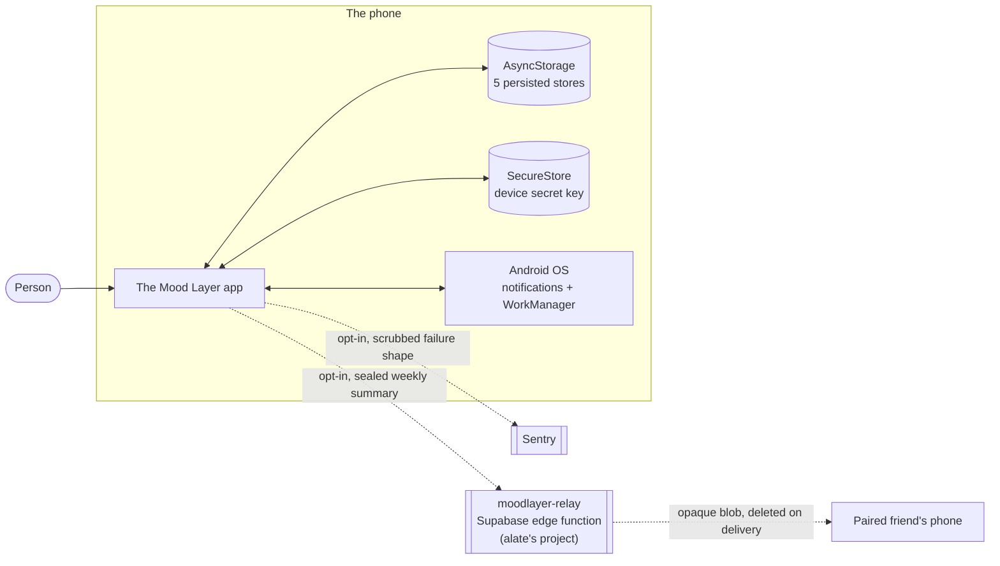
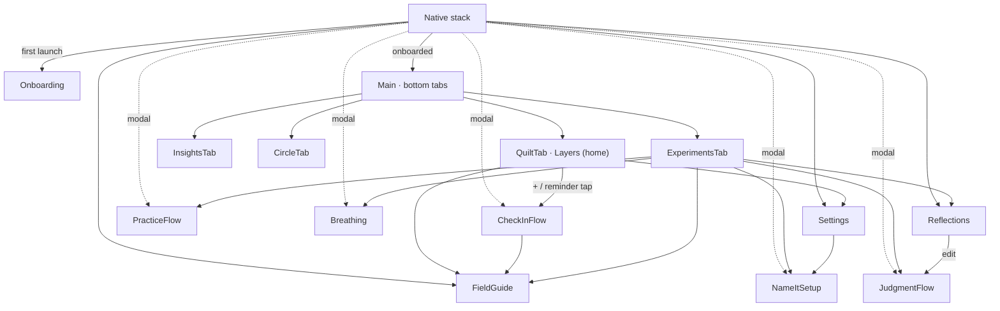
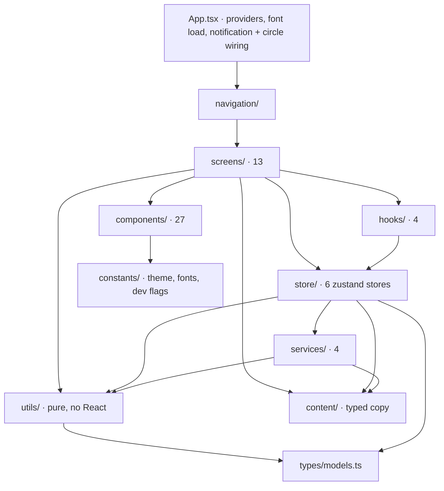
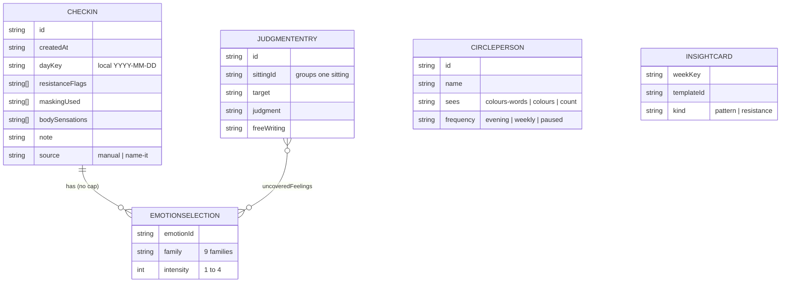
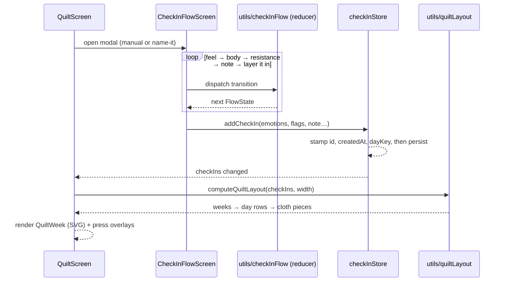
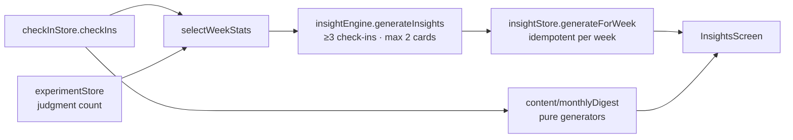
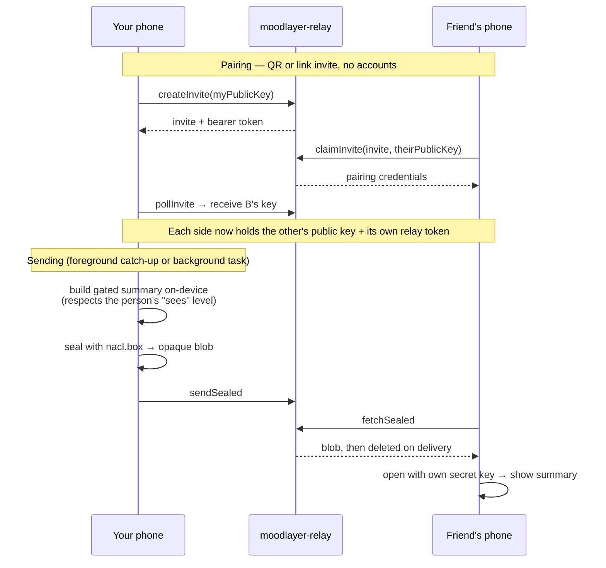

# Architecture — The Mood Layer

How the app is put together. Every path below was checked against the code on
2026-10-29 (`master` at `21bf143`); if you change one, change this page in the
same PR.

**The shape in one paragraph.** A single Expo/React Native app with no backend
of its own. Screens read **zustand stores** that persist to AsyncStorage on the
device. Anything that can be computed without React (layout, insights, flow
state, scheduling) is a **pure function in `utils/`**, unit-tested directly.
All user-facing words live in typed **`content/`** modules. **Services** wrap
the only things that touch the outside world: OS notifications, an OS
background task, an end-to-end-encrypted relay, and opt-in crash reports.

## Contents

1. [System context](#1-system-context)
2. [Navigation](#2-navigation)
3. [Layers and dependency rules](#3-layers-and-dependency-rules)
4. [Data model and persistence](#4-data-model-and-persistence)
5. [Key flows](#5-key-flows)
6. [Circle relay and the privacy boundary](#6-circle-relay-and-the-privacy-boundary)
7. [Design system](#7-design-system)
8. [Testing and guardrails](#8-testing-and-guardrails)
9. [Build, CI and release](#9-build-ci-and-release)
10. [Where do I put…?](#10-where-do-i-put)

---

## 1. System context

Solid lines never leave the phone. The two dashed lines are the **only**
network paths in the app, both opt-in, both reviewed
([§6](#6-circle-relay-and-the-privacy-boundary)). The relay lives in **alate's**
Supabase project, not this repo; `ops-watchdog.yml` watches for that project pausing.

## 2. Navigation

Source: [`src/navigation/AppNavigator.tsx`](../src/navigation/AppNavigator.tsx).

- **Initial route** is decided once at mount by the pure
  `pickInitialRoute(onboardingCompletedAt)`.
- **Every screen is wrapped** in a `Safe{Name}Screen` `ScreenErrorBoundary`, and
  `App.tsx` adds a root boundary around the navigator, helper sheet and
  providers. A render crash loses one screen, not the app.
- **Notification taps** route through `navigationRef`
  ([`navigationRef.ts`](../src/navigation/navigationRef.ts)), queued until
  `onReady`. Taps carry `{ route, source?, personId? }`: `CheckInFlow` opens a
  "name it" check-in; `Circle` opens the Circle tab and asks it to open the
  share sheet for that person.
- **No `linking` prop, deliberately.** An unreachable `query-string` advisory
  stays unreachable only because no URL ever reaches react-navigation's parser.
  Adding `linking` makes it live; re-open the triage in `docs/SECURITY.md`
  first.

## 3. Layers and dependency rules

| Layer | Rule | Examples |
|---|---|---|
| `utils/` | Pure functions. No React, no stores, no I/O. Unit-tested exactly. | `quiltLayout`, `checkInFlow`, `insightEngine`, `circleSchedule`, `notificationPlanner`, `dates` |
| `content/` | All user-facing strings and vocabulary as typed data. Copy changes go here, never inline. | `emotions`, `vocabulary`, `insights`, `practices`, `circle`, `monthlyDigest` |
| `store/` | State + persistence + pure selectors exported beside the store. | `checkInStore`, `circleStore` |
| `services/` | The edge of the app. Lazy-require native modules and no-op under Expo Go. | `notifications`, `circleRelay`, `crashReporting` |
| `screens/` | Render and dispatch. Step logic belongs in `utils/`, not here. | `CheckInFlowScreen` renders the `utils/checkInFlow` reducer |
| `components/` | Presentational pieces; colour only via `constants/theme`. | `QuiltWeek`, `Sheet`, `ScreenFrame`, `PaperTexture` |

Two cross-links worth knowing: `circleStore` reads `checkInStore` and
`experimentStore` (it builds the summary from them), and `settingsStore` calls
`crashReporting` (only the toggle may start or stop reporting).

**Path aliases:** `@/…` → `src/…` (see `tsconfig.json`, mirrored by
`babel-plugin-module-resolver` and jest).

## 4. Data model and persistence

Types live in [`src/types/models.ts`](../src/types/models.ts).

Nine families: Ekman's seven (anger, fear, sadness, disgust, enjoyment,
surprise, contempt) plus anticipation and trust from Plutchik's wheel.

| Store | AsyncStorage key | Holds | Persist version |
|---|---|---|---|
| `checkInStore` | `tml-checkins` | Check-ins, newest first | — |
| `experimentStore` | `tml-experiments` | Judgment entries, practice sittings, "name it" settings | 4 |
| `insightStore` | `tml-insights` | Generated weekly cards, last generated week | 2 |
| `circleStore` | `tml-circle` | People, pairing credentials, received summaries | — |
| `settingsStore` | `tml-settings` | Onboarding done, haptics, reduce-motion override, dismissed tips, crash-report consent | — |
| `helperSheetStore` | *(not persisted)* | Which emotion helper sheet is open | — |

Rules that follow from the model:

- **Dates are local time.** A 23:30 check-in belongs to the day it was felt.
  Week keys are ISO-8601 (`2026-W28`), hand-rolled in `utils/dates.ts`.
- **Migrations describe the past.** A store migration freezes the data shape of
  its version; don't reference live constants from one.
- **Delete is a true factory reset** of every on-device store (Settings).
- The device **secret key** is not in a store: it sits in `expo-secure-store`.

## 5. Key flows

### Check-in → layers on the home screen

`quiltLayout` returns plain geometry; `QuiltWeek` draws it as one SVG per week,
with real React Native `Pressable` overlays so screen readers can focus each
patch. Patterns are generated primitives, not SVG `<Pattern>` defs.
"Name it" check-ins may finish early once something is named.

### Weekly and monthly insights

`InsightsScreen` asks, on every focus, whether **last** ISO week has cards yet.
`useNowOnFocus()` makes "now" advance on focus, so views roll over on the first
open after a Monday or the 1st even if the app sat in memory.

### Reminders ("name it" and circle nudges)

`notificationPlanner` (pure) spreads N reminders across the waking window, on
the hour. `services/notifications` cancels and reschedules from that plan on
every settings change and stores the ids. `App.tsx` re-syncs circle reminders
on start, on every foreground, and whenever the people list changes.

## 6. Circle relay and the privacy boundary

The circle is the app's one peer-to-peer feature, and the first of its two
network exceptions. Full threat model: `docs/SECURITY.md` → "Circle relay".

What crosses the wire: **only** the same gated summary that "Share this week"
hands to the OS share sheet. Never check-ins, notes or reflections.

| Piece | File | Notes |
|---|---|---|
| Crypto + relay client | `services/circleRelay.ts` | tweetnacl seeded from `expo-crypto`; secret key in SecureStore |
| Due-send logic | `utils/circleSchedule.ts` | Pure. Evening sends after 18:00 local, once a day; weekly on Sunday after 18:00, once per ISO week |
| Orchestration | `store/circleStore.ts` | `runCircleAutoSend`, `syncCircleInbox`, `syncCircleReminders` |
| Background wake | `services/circleBackground.ts` | `expo-background-task` (WorkManager), floor of 60 minutes, Android decides the real moments; foreground catch-up in `App.tsx` covers the gap |
| Received-summary alert | `services/notifications.ts` | Local notification only |

**Crash reports** (the second exception) pass three gates before a byte leaves
the phone: consent (off by default, Settings toggle only), an Expo Go guard, and
a scrubber (`scrubEvent`) that strips `user`, IP, `request`, `extra`,
`contexts.state` and every non-navigation breadcrumb.
`src/__tests__/crashReporting.test.ts` holds that contract — a failure there is
a privacy regression, not a test to fix. Decision:
`memory/decisions/adr-001-crash-reporting.md`.

**Expo Go guard.** `expo-notifications`, `expo-task-manager`,
`expo-background-task` and `@sentry/react-native` are lazy-required and skipped
under Expo Go, where importing them crashes at import time. Every service
function degrades to a quiet no-op there.

## 7. Design system

- **One source of colour:** `src/constants/theme.ts`. `familyPalette` (pastels)
  is for layer fills, swatches, dials and the selected emotion chip;
  `mutedPalette` is for card fills, thread spines and section glyphs. Body text
  stays ink tiers; per-family `accent` is the only coloured text and must meet
  WCAG AA.
- **One font map:** `constants/fontAssets.ts`. Its keys are the `fontFamily`
  strings in the theme; a test pins them together because Android silently
  falls back to a system font on drift.
- **One page frame:** `components/ScreenFrame` gives every page screen the same
  paper ground, safe-area header and gutters; `PaperTexture` adds the grain.
- **One motion rule:** `hooks/useMotion` merges the OS reduce-motion setting
  with the app override. Every animation reads it.
- **Own bottom sheet:** `components/Sheet` is built on RN `Modal` + Reanimated
  rather than a library, because those libraries' Reanimated 4 / RN 0.83
  support was unproven.
- **Reanimated 4 in Jest:** the hand-rolled mock in `jest.setup.js` is
  load-bearing; the package's own mock would crash Node. Don't replace it.

## 8. Testing and guardrails

51 test files in `src/__tests__/`, run with jest-expo.

| Kind | Examples |
|---|---|
| Pure logic | `checkInFlow`, `quiltLayout`, `insightEngine`, `circleSchedule`, `notificationPlanner`, `dates` |
| Stores | `checkInStore`, `experimentStore`, `insightStore`, `settingsStore` |
| Screens | `screenSmoke` (every screen renders), per-screen suites |
| Design guardrails | `designTreatment` (tokens, contrast), `noHandTunedOffsets`, `noStitchLines`, `fontAssets`, `screenFrameSweep` |
| Content | `content.shape`, `fieldGuideContent`, `wordDefinitionContent` |
| Privacy | `crashReporting` (scrub contract), `circleRelay` |

A new screen needs a smoke test and a `Safe{ScreenName}` boundary in the
navigator. Bug fixes follow the log in `memory/project_regression_log.md`
(symptom → root cause → fix → test → lesson).

## 9. Build, CI and release

Builds are **cloud-only**; Metro, Expo Go, jest and tsc run locally.

| Workflow | Subject | Blocking? |
|---|---|---|
| `ci.yml` | `tsc`, jest, `npm audit` (critical), BACKLOG freeze guard. Also runs post-merge on `master` | **Yes — the merge gate** |
| `code-inspection.yml` | Shared forge code-standards ruleset | Advisory |
| `lint.yml` | ESLint (`eslint-config-expo`) | Advisory |
| `no-user-data.yml` | Scans the diff for credentials and data dumps (this repo is public) | Fails the check |
| `pr-gate-guard.yml` | PRs whose CI can't run at all (merge conflicts) | Visibility |
| `dependabot-auto-merge.yml` | Labels patch/minor `ready-to-merge`, comments on majors; merges nothing | — |
| `relock.yml` | Regenerates `package-lock.json` on a hosted runner | Manual |
| `build-android-apk.yml` | Manual dispatch → debug-signed arm64 APK. Push of a `v*` tag → signed APK + AAB, AAB uploaded to Play internal testing (promotion to production stays a manual Play Console click) | Manual / tag |
| `ios-release.yml` | iOS build submitted to TestFlight; a tag push is the only automatic trigger | Tag |
| `ops-watchdog.yml` | Scheduled check that the relay's Supabase project hasn't paused (inert until enabled) | Alerting |

Hooks stay light on purpose: `.husky/pre-commit` checks branch, secrets and file size; `pre-push` — docs-only
pushes run nothing, code pushes run `tsc`. CI is the real gate.
EAS profiles (`eas.json`): `development` and `preview` build APKs, `production`
builds an app bundle with auto-increment; Sentry source-map upload is disabled
in all three.

## 10. Where do I put…?

| I'm adding… | It goes in… |
|---|---|
| A screen | `src/screens/`, a `Safe*` wrapper + route in `AppNavigator`, a smoke test |
| User-facing copy | `src/content/` (typed data), then check ADR-003's terminology rules |
| A colour, font or spacing value | `src/constants/theme.ts` — never a literal |
| Logic with no UI | `src/utils/`, pure, with a unit test first |
| Persisted state | A zustand store with `persist`; add a `version` and migration if the shape changes |
| An animation | Gate it on `useMotion()` |
| A native module | Lazy-require it behind an Expo Go guard in `src/services/` |
| Anything that leaves the phone | Stop — it needs a decision record, a privacy review and a `docs/SECURITY.md` entry first |

See [`PROJECT_DOCS.md`](../PROJECT_DOCS.md) for where every other doc lives.
